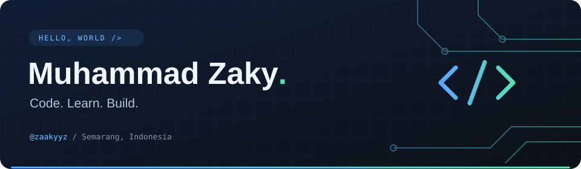

  

<h1 align="center">Hi there, I'm Zaky</h1>

  <b>Informatics Engineering graduate building mobile and web applications.</b> 
  Politeknik Negeri Semarang · Semarang, Indonesia

## About me

- I earned an **Associate Degree in Informatics Engineering** from **Politeknik Negeri Semarang**.
- I build mobile apps with **Flutter** and **Dart**, including responsive interfaces, **Riverpod** state management, and API integration.
- I create web interfaces with **React**, **Next.js**, and **TypeScript**, focusing on clear layouts and usability.
- I develop backend features with **Laravel**, **PHP**, and **MySQL**, including REST APIs, Firebase integration, and real-time communication.
- I explore **Python**, **OpenCV**, image processing, and computer vision. In team projects, I work through feature branches, reviews, and tests.

## Tech stack

  

## GitHub at a glance

  

  

  

---

<b>Thanks for stopping by!</b> Code. Learn. Build. Repeat.

